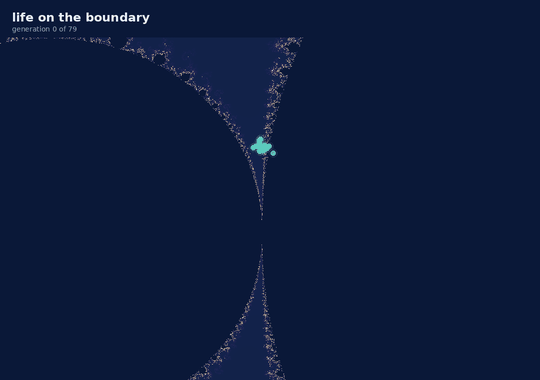
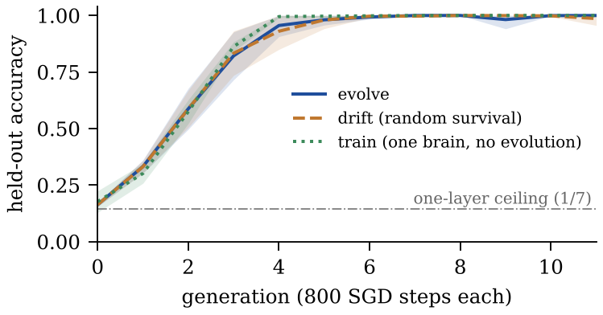

<p align="center">
  
</p>

<h1 align="center">Tesseract</h1>

<p align="center"><b>Self-replicating code organisms that evolve their own attention layers.</b></p>

<p align="center">
  <a href="LICENSE"></a>
  
  <a href="paper/tesseract.pdf"></a>
  <a href="CITATION.cff"></a>
</p>

Every organism here is a file. It reads its own source, decodes the genome
written inside it, earns energy on the edge of the Mandelbrot set and, if it
can afford to, writes a mutated copy of itself to disk. In the neural world
that genome is a small transformer: its weights, its architecture and a memory
of what it has seen. A child starts from what its parent learned, and a
mutation can give it a new attention layer without erasing anything.

The name comes from the four-dimensional cube: a system whose shape changes
along an axis you cannot see from the inside.

> **Not malware.** Organisms live in one directory, rewrite nothing but their
> own genome line, have no network access, and run under a 6 s timeout and a
> 512 MB memory cap. See [Containment](#containment). This is artificial-life
> research in the line of Tierra and Avida.

## Three findings

### 1. The predator that never ate

Predators in the first version refused to eat kin, and two organisms counted
as kin if they shared any ancestor among the last 24. The whole population
grows from one root, so for 24 generations everyone was everyone's cousin and
not one hunt could happen. The refusals had been blamed on a clonal
population. With kin limited to parents and grandparents, the neural world
makes 5 to 19 hunts per run (five seeds), and an 80-generation expression
world makes 62 while the hunting gene climbs from 0.05 to 0.40.

### 2. A layer born without forgetting

Any change of shape used to wipe the brain, so every mutant raced its trained
parents from random weights and starved; a mutation from two layers to one crashed the run
outright. `pill.morph()` now grows a brain without changing one output
(|Δ logit| < 1e-15): a new block starts as the identity, new width writes
zeros. Three-layer brains appeared in two of five runs, and in one the line
lived to the end. Under selection the single one-layer brain that was born
died; under random survival one lasted to the last generation.

### 3. Selection is not yet doing the work

<p align="center"></p>

The full world against two controls: the same world with survivors drawn by
lottery (**drift**), and one brain trained alone with no mutation and no
selection (**train**). All three cross 0.95 held-out accuracy between
generations 4 and 6 (mean over five seeds: evolve 4.4, drift 4.6, train 4.0).
A single brain trained alone is as fast as the population. What carries the
learning down a lineage is the inherited trained weights; on this task,
selection rides along. The next experiment follows from it: a task that one
learner cannot crack alone, because it shifts, splits into niches, or needs
more compute than one lineage gets.

## Run it

```bash
git clone https://github.com/myaslioglu/tesseract-alife && cd tesseract-alife
python3 spore.py --selftest                         # no dependencies: gradients, learning, a child
pip install numpy pillow
python3 world_net.py --gens 12 --K 12 --steps 800   # evolve attention (about 6 min on one core)
python3 world.py --gens 80 --K 60                   # evolve programs on the boundary
python3 fractal.py                                  # draw the colony into output/
```

## How it works

**Two worlds.** In the *expression world* (`world.py`) an organism is a
Python file with its genome on one line: an expression of at most 240
characters, a habitat coordinate, copy fidelity `mu`, metabolic efficiency
`eff`, `brood` size and `diet` (the chance of hunting). It evaluates its
expression on six integer lists, and to reproduce it rewrites its own genome
line with character-level mutations and writes the result as a child. The
copying happens inside the organism, not in the world that runs it.

In the *neural world* (`world_net.py`) the genome also carries `arch` (width,
MLP multiplier, layers, learning rate), float32 `weights` and a `memory` of up
to 32 examples. Each generation an organism trains 800 steps of clipped SGD on
fresh batches plus its memory, then is scored on 128 sequences it has never
seen. Children inherit the trained weights, mutated.

**The brain** (`pill.py`) is a causal transformer with hand-written
backpropagation in NumPy, checked against finite differences (4e-10).

**The task** is induction: eight distinct tokens from a vocabulary of 12, then
a repeat of one of them; predict the token that followed it. One head has to
tag each position with its predecessor and a second has to read the tag, so
depth is causal here, not decoration:

| model, 800 steps (`python3 pill.py`) | held-out accuracy |
|---|---|
| 2 layers, d = 32 | **1.00** |
| 1 layer, d = 32 | 0.14 (copy a random earlier token: 1/7) |

**The habitat.** Fertility at `(cr, ci)` is the Mandelbrot escape time scaled
to [0.35, 2.75], and 0.30 inside the set, so only the boundary is rich. The
iteration cap grows by three each generation, so points that looked frozen
become coastline.

**Energy.** `gain = pts · fertility · eff^0.5`, `upkeep = 6 · eff²`. Nothing
bounds `eff`; its optimum falls out of the curve,
`eff* = (pts · fertility / 24)^(2/3)`. The `K / mean brood` organisms with the
most energy survive and split their energy among their children.

**Growing a layer.** Architecture mutates in 2% of births: ±1 layer, ±1 MLP
multiplier, or a new width. `morph()` keeps the old weights. An inserted block
has `Wo = W2 = b2 = 0`, so it is the identity until it learns otherwise; new
width reads from the residual stream but writes zeros into it; `Wq` is
rescaled so attention keeps its temperature. Growth is exact. Shrinking
throws weights away.

**Predation.** A hunter pays 4 energy, takes 45% of a neighbour's energy,
adopts its expression or its whole brain, and forages at 60% that generation.
Prey must not be kin (a shared parent or grandparent, `--kin`) and must be
foreign: different code, or a relative weight distance of at least 0.10
(`--foreign`; siblings sit at 0.06, second cousins at 0.12, unrelated brains
at 1.4). Refusals are logged as `kin` or `clone`.

**The spore.** `spore.py` is the whole organism in one file with no
dependencies. Its genome (id, lineage, trained weights) sits on its own `_G`
line; `--train` rewrites that line, `--spawn` writes children that are this
same file with a mutated genome. Copy it to any machine with Python and it
lives. Its brain is small (d = 8) because pure Python is 52 times slower than
NumPy here.

```bash
cp spore.py adam.py                # --train rewrites the file it runs from
python3 adam.py --train 400
python3 adam.py --spawn 3 kids/
python3 kids/s001-*.py             # each child reports who it is and how good
```

## Containment

- organisms are written into one population directory and never leave it
- an expression must pass an AST whitelist before it runs: arithmetic,
  comparisons, booleans, conditionals, comprehensions, calls to nine
  built-ins, names, literals; no attribute access, imports or assignment
- each organism runs in a subprocess with a 6 s timeout and a 512 MB
  address-space limit, so `c*10**9` passes the whitelist, dies of
  `MemoryError` and starves (macOS ignores the memory limit; there only the
  timeout holds)
- no sockets in organism code; only the environment may fetch a corpus
- a child that mutates into nonsense dies instead of running

## Reproduce the paper

```bash
for s in 7 8 9 10 11; do
  python3 world_net.py --gens 12 --K 12 --steps 800 --seed $s
  python3 world_net.py --gens 12 --K 12 --steps 800 --seed $s --control drift
  python3 world_net.py --gens 12 --K 12 --steps 800 --seed $s --control train
done
python3 world.py --gens 80 --K 60 && python3 fractal.py
```

The records of every run in the paper are in [data/](data/), and
`python3 paper/make_figure.py` rebuilds Fig. 1 and the numbers above from them.
Each new run writes `net_world*.jsonl` (one record per generation) and a
`net_report*.md` table. A seed fixes every random draw in the neural world,
though floating-point differences between machines can still nudge a run. The
expression world is not seeded.

## Honest limits

1. **Selection is not yet doing the work** on this task; see finding 3.
   Evolution should matter where one learner cannot get there alone: a task
   that shifts, competing niches, or a compute budget too small for one
   lineage.
2. **Small and few.** K = 12, five seeds, one task; the expression-world
   numbers come from single runs. Each organism is scored on 128 sequences, a
   standard error of about ±0.04.
3. **Retention flatters itself.** Replayed examples score high because they
   were trained on. Held-out accuracy is the number that counts.
4. **Metabolism does not track habitat** in the expression world. Theory says
   rich ground selects a heavy `eff`; the data shows no sorting. Untested
   candidates: migration erases local adaptation, or the payoff is flat near
   its optimum (at a perfect score on fertility 1.5, ±20% `eff` costs about
   0.36 energy, less than the rounding of gain and upkeep).
5. **Pure Python trades reach for size.** The spore runs anywhere, but at
   d = 8 it stays at the copy-a-random-token level (0.14 after 300 steps).

## Versions

The tag **`v0`** keeps the original code. What changed since, and why, is in
[pull request #1](https://github.com/myaslioglu/tesseract-alife/pull/1): the
kin window, the two-to-one-layer crash, the wipe-on-mutation handicap, the missing memory
cap, a spore that did not replicate, and a results table that did not
reproduce from its own code. [docs/WORLD.md](docs/WORLD.md) has the expression
world in full.

## Cite

If you use this code, please cite the software; GitHub's *Cite this
repository* button reads [CITATION.cff](CITATION.cff).

```bibtex
@software{yaslioglu_tesseract_2026,
  author  = {Ya{\c{s}}l{\i}o{\u{g}}lu, Muhsin Murat},
  title   = {Tesseract: self-replicating code organisms that evolve their own attention layers},
  year    = {2026},
  version = {1.0.0},
  url     = {https://github.com/myaslioglu/tesseract-alife}
}
```

The paper is in [paper/](paper/) ([PDF](paper/tesseract.pdf)).

MIT licensed.
