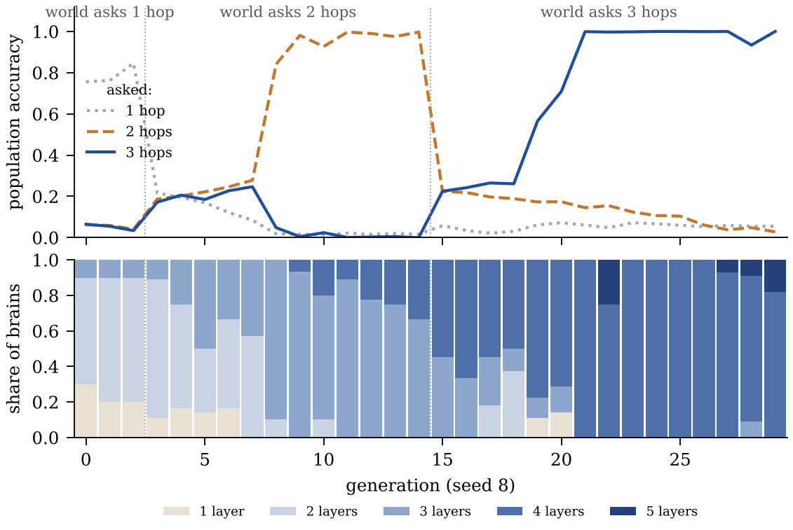

# evolve-2: a world that deepens

On the one-hop task of the paper, one brain trained alone learned as fast as
the whole population: the task gave selection nothing to do. evolve-2 keeps
changing what the brains have to be.

## The task

k-hop induction (`pill.make_hops`). The prefix lists the six edges of a path
x0 → x1 → … → x6 as (a, b) pairs in random order, a marker token says how many
hops are asked, the query is a node x_j, and the answer is x_{j+k}. Each hop is
one more lookup that depends on the one before it, and the pair that answers it
can sit anywhere in the list.

Depth is now required. One brain from scratch, 16,000 steps
(`python3 pill.py --hops`):

| layers | 1 hop | 2 hops | 3 hops |
|---|---|---|---|
| 2 | 1.00 | 0.37 | 0.25 |
| 3 | 1.00 | 1.00 | 0.64 |
| 4 | 1.00 | 1.00 | 1.00 |
| 5 | 1.00 | 1.00 | 1.00 |

k hops need k + 1 layers.

## The world

- `--eras 3,12,15`: three generations of one hop, twelve of two, then fifteen
  of three. Each era asks only its own depth: with one-hop and two-hop
  questions mixed in every batch, a three-layer brain stays near chance on two
  hops for 8,000 steps (`python3 docs/probes_evolve2.py mix`). Memory still
  replays old questions, marker and all.
- `--momentum 0.9`: the paper's learner (plain SGD) is about four times
  slower, and an era would need 20 to 30 generations.
- `--arch-mu 0.3 --max-layers 6`: the architecture mutates in 30% of births. A
  new layer is inserted as the identity (`pill.morph`), so a deeper child
  starts out behaving exactly like its parent.

With none of these flags the world is the paper's: seed 7 reproduces its run
exactly.

Four arms, five seeds each (7 to 11), K = 12, 800 steps per life:

- **evolve**: the full world;
- **drift**: the same world, survivors drawn by lottery;
- **one brain, 2 layers**: no mutation, no selection;
- **one brain, 4 layers**: the same, born with the depth the last era needs.

## Results

<p align="center"></p>

A run counts as recovered when its population's mean accuracy reaches 0.9
within the era. The per-seed numbers are mean accuracy over the era's last
three generations, seeds 7 to 11 in order.

| arm | 2 hops: recovered | last 3 generations | 3 hops: recovered | last 3 generations |
|---|---|---|---|---|
| evolve | 2 of 5 | 0.21 0.99 0.98 0.29 0.24 | 1 of 5 | 0.33 0.98 0.61 0.24 0.18 |
| drift | 0 of 5 | 0.19 0.24 0.75 0.20 0.19 | 0 of 5 | 0.19 0.19 0.40 0.26 0.18 |
| one brain, 2 layers | 0 of 5 | 0.19 0.19 0.18 0.17 0.19 | 0 of 5 | 0.21 0.21 0.18 0.18 0.21 |
| one brain, 4 layers | 5 of 5 | 1.00 1.00 1.00 1.00 1.00 | 1 of 5 | 0.53 0.78 0.52 0.56 1.00 |

<p align="center"></p>

What the runs show:

1. **The world outgrows a fixed brain.** A brain of the old depth stays at
   chance for all 27 generations after the first era.
2. **A population can grow the depth it needs.** In two of five runs a deeper
   lineage learned two hops and swept the population within one or two
   generations (seed 8: 0.25, 0.84, 0.99). In seed 8 the population then went
   on to four layers and solved three hops as well: two layers became three
   when the world asked for two hops, and three became four when it asked for
   three.
3. **Random survival never swept.** Deep brains arose under drift as often as
   under selection, and mean depth even ended higher (3.7 against 3.4), but
   nothing kept the ones that learned. Depth alone means nothing; the footprint
   of selection is in which deep brains survive.
4. **Evolution did not beat knowing the answer.** A single brain born with
   four layers solved two hops in every run, in three to five generations, on
   a twelfth of the population's compute. Evolution found depth it was not
   told about; it did not do better than being told.
5. **A partial solution can trap a population.** In seed 9, three-layer
   brains reached about 0.6 on three hops (the ceiling the table above shows
   for three layers), and the four-layer mutants that appeared lost to them.
6. **Each era's gain erases the last.** After an era change, the old skill
   decays to chance; memory replay does not hold it.

When a grown brain finally learns two hops is heavy-tailed: with no mutation
at all, one three-layer brain grown from a one-hop parent learned in its first
800-step life, and another was still stuck after fifteen
(`python3 docs/probes_evolve2.py clicks`). A population holds many such
tickets at once, and selection keeps the first to win. That is what happened in
seeds 8 and 9, and not in the other three.

**Statistics.** Evolve against drift, on accuracy over the era's last three
generations, one-sided exact permutation test over all 252 splits: p = 0.09
for two hops, p = 0.12 for three. Suggestive, not significant with five seeds.

## Limits

- Five seeds per arm, one task family, populations of twelve.
- The world deepens on a clock that was set by hand, not in response to the
  population.
- The population spends twelve times the compute of a single brain.
- Momentum, the architecture mutation rate and the era lengths were chosen
  after pilots: with a mutation rate of 0.2 and eras of eight generations, one
  pilot never recovered from the change to two hops. The settings were then
  fixed, and the same for every arm.

## Reproduce

```bash
for s in 7 8 9 10 11; do
  for arm in "" "--control drift" "--control train --layers 2" "--control train --layers 4"; do
    python3 world_net.py --gens 30 --K 12 --steps 800 --seed $s --eras 3,12,15 \
      --momentum 0.9 --arch-mu 0.3 --max-layers 6 $arm
  done
done
python3 docs/make_evolve2.py          # rebuilds the figures and the numbers above from data/evolve2/
```

Run each arm in its own folder: runs of the same arm write to the same log
files. The records of all twenty runs are in [data/evolve2/](../data/evolve2/).
