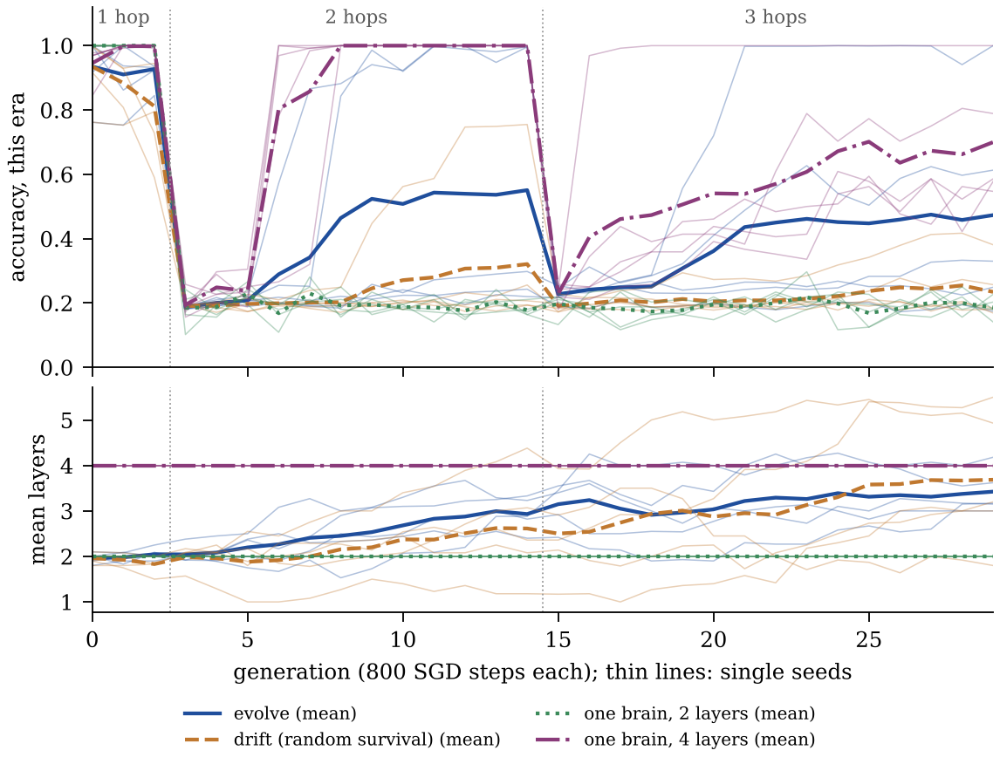

# evolve-2: a world that deepens

On the one-hop task of the paper, one brain trained alone learned as fast as
the whole population: the task gave selection nothing to do. evolve-2 keeps
changing what the brains have to be.

## The task

k-hop induction (`pill.make_hops`). The prefix lists the six edges of a path
x0 → x1 → … → x6 as (a, b) pairs in random order, a marker token says how many
hops are asked, the query is a node x_j, and the answer is x_{j+k}. Each hop is
one more lookup that depends on the one before it, and the pair that answers it
can sit anywhere in the list.

One brain from scratch, width 32, 16,000 steps (`python3 pill.py --hops`):

| layers | 1 hop | 2 hops | 3 hops |
|---|---|---|---|
| 2 | 1.00 | 0.37 | 0.25 |
| 3 | 1.00 | 1.00 | 0.64 |
| 4 | 1.00 | 1.00 | 1.00 |
| 5 | 1.00 | 1.00 | 1.00 |

In this setting two hops needed three layers and three hops needed four. That
is a property of this width and budget, not a law: k-hop induction can be
solved at a depth that grows like log k (Sanford, Hsu and Telgarsky, 2024), and
the 0.64 for three layers on three hops is where training stood at 16,000
steps, not a proven ceiling.

## The world

- `--eras 3,12,15`: three generations of one hop, twelve of two, then fifteen
  of three. Each era asks only its own depth: with one-hop and two-hop
  questions mixed in every batch, a three-layer brain stays near chance on two
  hops for 8,000 steps (`python3 docs/probes_evolve2.py mix`). Memory still
  replays old questions, marker and all.
- `--momentum 0.9`: with the paper's plain SGD, one hop took four generations
  (data/neural, train arm); with momentum it takes one or none.
- `--arch-mu 0.3 --max-layers 6`: the architecture mutates in 30% of births
  (one layer more or less, a new width, or a new MLP size). A new layer is
  inserted as the identity (`pill.morph`), so a deeper child starts out nearly
  identical to its parent; birth noise perturbs the new block like every other
  weight.

With none of these flags the world is the paper's: seed 7 reproduces its run
exactly.

Four arms, five seeds each (7 to 11), K = 12, 800 steps per life:

- **evolve**: the full world;
- **drift**: the same world, survivors drawn by lottery;
- **one brain, 2 layers**: no mutation, no selection;
- **one brain, 4 layers**: the same, born with the depth the last era needs.

## Results

<p align="center"></p>

A run counts as recovered when its population's mean accuracy reaches 0.9
within the era. The per-seed numbers are mean accuracy over the era's last
three generations, seeds 7 to 11 in order.

| arm | 2 hops: recovered | last 3 generations | 3 hops: recovered | last 3 generations |
|---|---|---|---|---|
| evolve | 2 of 5 | 0.21 0.99 0.98 0.29 0.24 | 1 of 5 | 0.33 0.98 0.61 0.24 0.18 |
| drift | 0 of 5 | 0.19 0.24 0.75 0.20 0.19 | 0 of 5 | 0.19 0.19 0.40 0.26 0.18 |
| one brain, 2 layers | 0 of 5 | 0.19 0.19 0.18 0.17 0.19 | 0 of 5 | 0.21 0.21 0.18 0.18 0.21 |
| one brain, 4 layers | 5 of 5 | 1.00 1.00 1.00 1.00 1.00 | 1 of 5 | 0.53 0.78 0.52 0.56 1.00 |

What the runs show, and what they do not:

1. **The world outgrows a fixed brain.** A brain of the old depth stays at
   chance for all 27 generations after the first era.
2. **Depth grows with or without selection.** One layer more or less, with the
   depth kept between 1 and 6, is a random walk that spreads depth out toward
   an average of 3.5 even when nothing selects. Under drift, mean depth ended
   at 3.7, against 3.4 under selection (over the whole run, 2.65 against 2.82).
   Deeper brains were present before each era asked for them: seed 8 had a
   three-layer brain in generation 0, and its four-layer brains appeared from
   generation 9, six generations before three hops were asked. A rising layer
   count is not, by itself, a sign of adaptation.
3. **Evolving populations recovered more often than drifting ones, at this
   sample size not significantly.** Two of five evolving runs recovered from
   the step to two hops, none of the drifting runs did. A solving brain
   (best organism at 0.9 or more) appeared in two evolving runs and in one
   drifting run, seed 9, where the solver lasted six generations and the
   population mean climbed to 0.76 without crossing 0.9. Once a solver was
   present, the evolving populations reached 0.9 within one to three
   generations in three of four cases; in the fourth (seed 9, three hops) the
   solvers were lost, see 5. The one drifting case climbed for five
   generations and stopped short.
4. **The jumps were simultaneous, not a sweep from one winner.** In seed 8 no
   brain had solved two hops in generation 7 (best 0.29); in generation 8 at
   least eight of ten had, all children of five parents that had not, in a
   population already nine-tenths three-layer. Seed 9 shows the same: best
   0.31 in generation 5, at least five of twelve solving in generation 6.
   Children inherit trained weights, so relatives carry the same partly formed
   circuit and can cross the threshold in the same life. The logs of these
   runs hold population summaries only, so which lineages crossed cannot be
   checked; runs from now on also log every organism (`net_organisms*.jsonl`).
5. **Selection can lose its best brains.** In seed 9, during the three-hop era,
   a brain at 0.99 or 1.00 appeared in generations 20, 22 and 23, and each time
   the brain with the most energy was only at 0.56 to 0.67; the next
   generation's best was at most 0.59. Survival ranks energy, and energy is
   inherited energy plus this life's gain, so a new solver can be outranked.
   The population settled on three-layer brains at about 0.6.
6. **The three-hop era measures the curriculum as much as depth.** A four-layer
   brain from scratch learns three hops within 16,000 steps (the table above;
   within 8,000 to 10,000 in three of three seeds checked by the review), but
   in the world, after an era of two hops, the four-layer brain solved it in
   one run of five. Two candidate causes, not separated: replay fills half of
   every batch with the previous era's questions for about four generations,
   and the brain starts from an inherited two-hop solution.
7. **Brains ignore the hop marker.** In the evolving runs that solved a new
   depth (seeds 8 and 9), accuracy on the old depths fell to 0.00 to 0.06,
   below the 0.16 to 0.27 of a brain that never solved anything: they answer
   at the current depth whatever the marker asks. Replay cannot keep the old skill, since the
   buffer turns over within a few generations.
8. **Evolution did not beat knowing the answer.** A single brain born with
   four layers solved two hops in every run, in three to five generations, on
   an eleventh of the population's brain lives (30 against 334 per run; about
   an eighth weighted by layers).

## Confounds

- **Drift differs in more than survival.** It skips the starvation rule, so
  its populations stay larger (smallest population 9 to 10, against 4 to 8
  under evolve). Hunting is rarer under drift (1 to 7 hunts per run, against 8
  to 50), because the diet gene is only selected under evolve, and a hunt
  copies a whole brain, so predation may have spread solvers in the evolving
  runs.
- **Depth is not the only thing that evolves.** Width, MLP size and learning
  rate mutate too; the fittest brains in solving generations had widths from
  16 to 48. The four-layer single brain stays at width 32, MLP multiplier 2,
  learning rate 0.05.
- **The single brains carry no mutational load.** In the populations, the 1%
  chance per tensor of a hard reset hits at least one tensor in about a
  quarter of births.
- **Missing baselines.** A population of the same size with random fixed
  depths and no selection, and a single brain that grows a layer with `morph`
  whenever it stalls, would separate selection from search.
- **Settings were chosen after pilots** (with an architecture mutation rate of
  0.2 and eras of eight generations, one pilot never recovered from the step to
  two hops), and the pilot logs were not kept. The tests below are
  exploratory.

## Statistics

Evolve against drift, difference in means of the last-three-generation
accuracy, one-sided exact permutation test over all 252 splits of the ten
runs: p = 0.09 for two hops, p = 0.12 for three. On recovery counts (2 of 5
against 0 of 5), Fisher's exact test gives p = 0.22. With five seeds none of
these is significant.

When a grown brain finally learns two hops varies widely: with no mutation at
all, one three-layer brain grown from a one-hop parent learned in its first
800-step life, and another was still near chance after fifteen
(`python3 docs/probes_evolve2.py clicks`, two seeds per condition). A
population holds many such tickets at once, which is one reason it could beat
a lone learner of unknown depth; these runs do not show how often it does.

## Limits

- Five seeds per arm, one task family, populations of twelve.
- The world deepens on a clock set by hand, not in response to the population.

## Reproduce

```bash
for s in 7 8 9 10 11; do
  for arm in evolve drift train2 train4; do
    case $arm in
      evolve) flag="" ;;
      drift)  flag="--control drift" ;;
      train2) flag="--control train --layers 2" ;;
      train4) flag="--control train --layers 4" ;;
    esac
    mkdir -p runs/$arm-s$s && cp pill.py world_net.py runs/$arm-s$s/
    (cd runs/$arm-s$s && python3 world_net.py --gens 30 --K 12 --steps 800 --seed $s \
       --eras 3,12,15 --momentum 0.9 --arch-mu 0.3 --max-layers 6 $flag)
  done
done
python3 docs/make_evolve2.py      # rebuilds the figures and numbers above from data/evolve2/
```

The records of all twenty runs, and the settings they share, are in
[data/evolve2/](../data/evolve2/).

Sanford, C., Hsu, D., and Telgarsky, M. (2024). Transformers, parallel
computation, and logarithmic depth. *ICML 2024*. arXiv:2402.09268.
